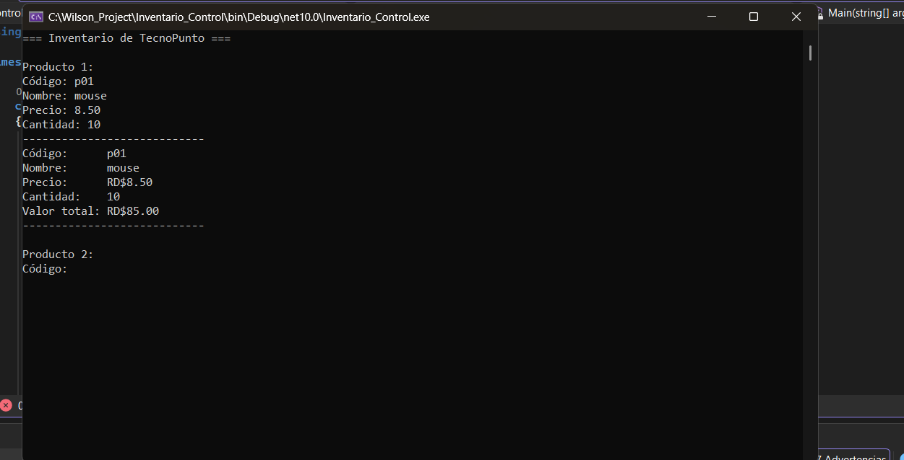
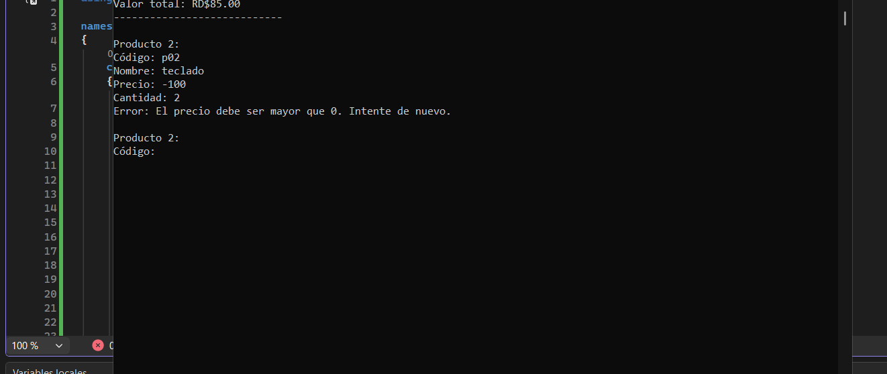
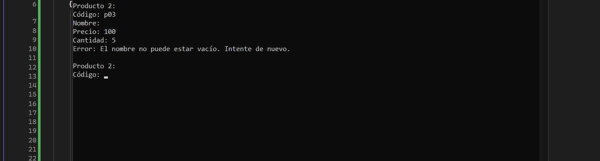
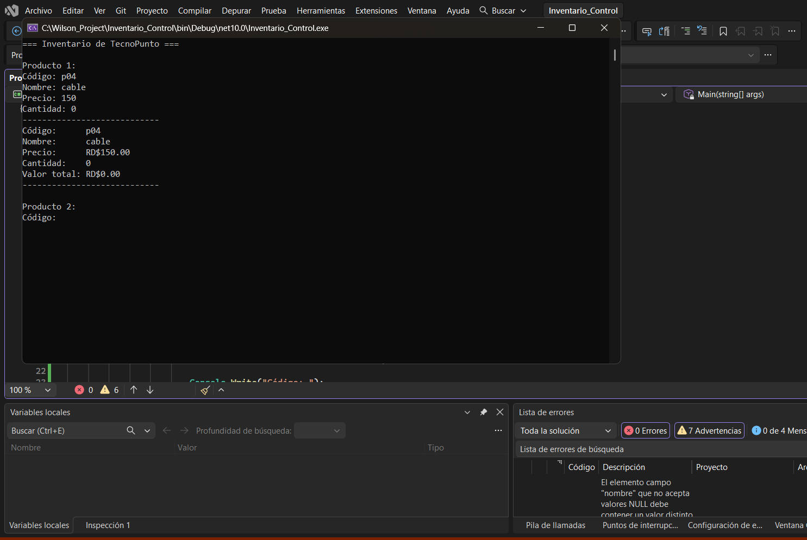

# Control de inventario de TecnoPunto

*Wilson Alejandro Abreu Santana (2025-2391)
*Vladimir Corrielan Jose (2025-2527)
*Rotciv Rayleend Ozuna (2025-2501)

- Asignatura: Programación Básica
- Profesor: Gamalier Reyes del Carmen

 Descripción del programa
Aplicación de consola en C# que registra productos de la tienda TecnoPunto. Usa la clase `Producto` con propiedades que validan los datos, evitando precios negativos, cantidades inválidas y productos sin nombre. Cada producto calcula por sí mismo el valor total que tiene en existencia.

#Datos de entrada
- Código del producto
- Nombre
- Precio
- Cantidad

 Datos que procesa
- Valida que el nombre no esté vacío.
- Valida que el precio sea mayor que 0.
- Valida que la cantidad no sea negativa.
- Calcula el valor total (Precio × Cantidad) con la propiedad de solo lectura `ValorTotal`.
- Si un dato es inválido, muestra un mensaje claro y vuelve a pedirlo, sin cerrar el programa.

 Datos de salida
Código, nombre, precio, cantidad y valor total de cada producto registrado.

#Capturas de ejecución

### Datos válidos

### Precio negativo

### Nombre vacío

### Cantidad cero

